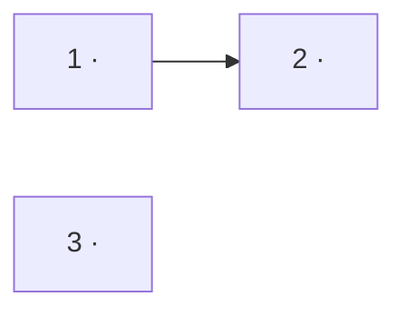

# Plan NNNN: <Title>

<!-- Delete every comment like this one when filling the template in. -->

- **Status:** draft <!-- draft | in progress | blocked | done. Optionally followed by " — " and one sentence: what is next, or what blocks. -->
- **Last modified:** YYYY-MM-DD <!-- Update whenever any plan file changes, including iteration-only edits. -->

## Read first

<!-- Documents an agent must load before touching this plan, because the plan is not understandable or safe to change without them. Soft cap of three: if the list grows past that, most entries probably belong in an iteration document. A parent-plan link requires shared scope and constraints, not all its iterations. Omit the section if nothing qualifies. -->

- [<Document>](<path>) — <why it is essential>

## Goal

<!-- What this plan delivers and why, in a short paragraph or a short numbered list. Written so it stays true for the whole life of the plan. -->

## Non-goals

<!-- What a reader might reasonably expect this plan to cover but it deliberately does not. One clause of rationale each. -->

-

## Dependencies

<!-- What must be true before work can start or finish: other plans, recorded decisions, access, external teams. Say who or what owns each, and what happens if it slips. Omit the section if there are none. -->

-

## Iteration graph

<!-- Use the project's existing diagram convention. If it has none, adapt the Mermaid example below when Mermaid is supported; otherwise replace it with a textual dependency list (for example, "Iteration 2 depends on 1" and "Iteration 3 has no dependencies"). Every iteration appears, including those with no dependencies. An arrow from A to B means B cannot start or be verified until A is done. Colour each node by status with the classes below; leave not-started nodes unclassed. Update it whenever an iteration is added, dropped, started or finished. -->

## Iterations

<!-- Link each iteration document and summarize its purpose in one short sentence; keep descriptions and statuses current with those documents and the graph. Numbers are permanent labels, not execution order. Append new numbers; remove unused examples. Keep detailed intent, approach and outcome in the iteration documents. -->

| Iteration | Description | Status |
| --- | --- | --- |
| [1 — <Title>](iterations/01-short-slug.md) | <One short sentence stating its purpose.> | not started |
| [2 — <Title>](iterations/02-short-slug.md) | <One short sentence stating its purpose.> | not started |
| [3 — <Title>](iterations/03-short-slug.md) | <One short sentence stating its purpose.> | not started |

## Exit criteria

<!-- What must hold for the plan as a whole to be done. Stated as facts that can be checked, not as a list of the iterations. Do not change these without the user's agreement. -->

-

## Open questions

<!-- Unsettled questions affecting the whole plan; put iteration-specific questions in that document. Say what each question blocks. Delete a question when it is answered and fold the answer into the part of the plan it affects. Omit the section if there are none. -->

-
